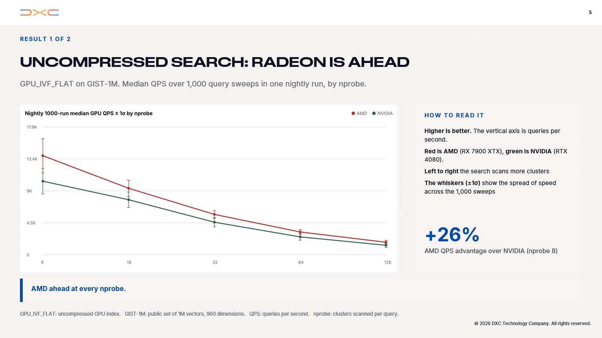
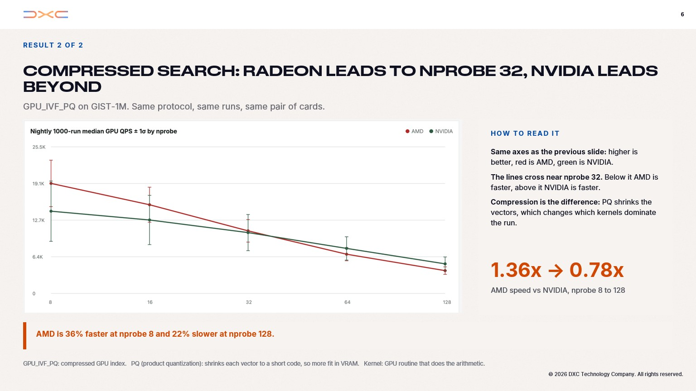

# Nearest-neighbour search in Milvus, on a Radeon

*A CUDA-to-HIP port that returns the same neighbors. First draft — one text for Medium, LinkedIn (cut later), and the AMD blog.*

*Figures: crop* `Deck/Slide5.jpg` *and* `Deck/Slide6.jpg` *to the charts before publishing; the files in the repo are still full DXC slides. Hardware from* `Deck/Slide12.jpg`*. Do not mix in older one-shot harness tables when they disagree with these dashboard plots.*

---

The machine on the desk was a Ryzen 7 7700X and a Radeon RX 7900 XTX. 64 GB of RAM. Ubuntu 22.04. A consumer box. I wanted a RAG stack: text turned into embeddings (long lists of numbers), then a lookup that, for a new embedding, finds the closest stored ones. That lookup is approximate nearest-neighbour search (ANN). People keep the vectors in a vector database. I wanted the heavy lookup on the GPU, in the database people actually use for that.

I picked Milvus because it is the most popular open-source vector database for RAG / ANN (~46k GitHub stars). On NVIDIA, Milvus already does that ANN on the GPU. On a consumer Radeon it did not.

CPU Milvus already ran on the same host. That was not the question — the CPU can find nearest neighbours; it is just slower, and it was not the missing piece. Stock GPU images are NVIDIA. The search engine, Knowhere, talks to cuVS / RAFT. hipVS 0.1.0, the AMD analog, covers Instinct in the datacentre. On this RX 7900 XTX, those GPU indexes did not run. The card was in the case. Milvus had nothing on it for ANN. I took the CUDA search code and started making it run as HIP on this machine.

Two index types, end to end, on an RX 7900 XTX: `GPU_IVF_FLAT` (vectors kept uncompressed inside IVF clusters) and `GPU_IVF_PQ` (product quantization, less VRAM, a recall tax). Public tech-preview line: Milvus v2.5.4, Knowhere rebuilt through HIP, hipVS underneath. Same test suite on the NVIDIA build and the AMD build. Neighbours have to match.

The NVIDIA box came later. The AMD machine was enough to make search work. Once it did, colleagues pushed, and I found funding for a GeForce RTX 4080 (16 GB) so we could measure both ports on the same queries and put numbers in public. Not because the port needed NVIDIA to exist. Because a claim without a peer card is a blog comment.

## What we actually changed

Milvus does not call cuVS from Python. The client hits the server. The server hits Knowhere. Knowhere owns the GPU indexes. Under that:

```
pymilvus
    -> Milvus server
        -> Knowhere
            -> GPU_IVF_FLAT / GPU_IVF_PQ
                -> NVIDIA: RAFT / cuVS
                -> AMD:    hipRAFT / hipVS   (ROCm-DS + gfx1100 patches)
```

A Docker pull of the NVIDIA GPU image does not run on a Radeon. A CPU/Lite install does not exercise this path. GPU on AMD is a source build.

We did not swap cuVS for hipVS in one weekend and declare victory. The work went in layers, with a gate that had to go green before the next one:


| Layer | What                | Pass                                                          |
| ----- | ------------------- | ------------------------------------------------------------- |
| 0     | ROCm + CPU Milvus   | `gfx1100` visible; Standalone healthy                         |
| 1     | hipRAFT / hipVS     | Build; neighbour tests                                        |
| 1.5   | IVF packer on RDNA3 | Float IVF gtests 98/98 after `kIndexGroupSize = 32` (warp 32) |
| 2     | Knowhere + HIP      | GPU L2 search tests green                                     |
| 3     | Milvus source       | Sealed `GPU_IVF_*` build / load / search                      |
| 4     | Fair benches        | Same correctness gate as CUDA; QPS vs nprobe                  |


Layer 1.5 is the one I would rather forget. NVIDIA warps are 32 threads. A lot of RDNA3 code still thinks in 64. The IVF packer grouped the wrong way. Search returned empty neighbours, or the wrong IDs. The logs looked fine until you checked recall. The fix is unglamorous: `kIndexGroupSize = 32` with `USE_WARPSIZE_32`. After that, the float IVF gtests went 98/98.

We also tried a cleverer PQ score loop. No QPS win. Reverted. The change that did stick on the library side was an AMD-default launch of `blockDim = 512` on hipVS PQ search — occupancy heuristics in stock hipVS were NVIDIA-shaped. That is a library microbench, not the Milvus QPS below. Do not mix the two plots.

`GPU_CAGRA` is not in the “done” column for this article. Unfiltered search exists in the lab. Filtered / bitset / deletes are not a thing we will headline. Next index on the list, not this release.

## How we ported with agents

I sit in Cursor. I use Grok. Other people on the team use other agents. The agents search, draft patches, argue with CMake. I still have to run the gate and decide whether a number ships.


## Two cards, one nightly sweep

Once the 4080 existed, both machines ran the same dataset, the same queries, the same index recipes, every night.


|           | AMD                                 | NVIDIA                                                           |
| --------- | ----------------------------------- | ---------------------------------------------------------------- |
| GPU       | Radeon RX 7900 XTX, 24 GB           | GeForce RTX 4080, 16 GB                                          |
| CPU       | Ryzen 7 7700X, 8 cores / 16 threads | 16 logical CPUs (model not recorded)                             |
| RAM       | 64 GB DDR5                          | ~61 GiB visible to the OS                                        |
| OS        | Ubuntu 22.04.5 LTS                  | Ubuntu 22.04.5 LTS                                               |
| GPU stack | ROCm 7.0.2                          | CUDA 11.8 in the Milvus build; 12.8 in a separate cuVS container |


These two cards shipped four weeks apart in late 2022. They are not the same silicon. 24 GB vs 16 GB. The dataset we publish here, GIST-1M (one million 960-d vectors, about 3.8 GB), fits in VRAM on both. This bench does not speak to collections larger than the card.

Protocol: nightly CI repeats the same query sweep 1,000 times on each card. We keep runs that pass the exact-kNN correctness gate. We plot median GPU QPS against nprobe. Whiskers are ±1σ across those 1,000 sweeps. nprobe is how many IVF clusters a query scans — higher is more accurate and slower, which is why the result is a sweep, not a single bar.

Correctness first. If the neighbours are wrong, the QPS is a toy.

## Uncompressed search: Radeon is ahead

`GPU_IVF_FLAT` on GIST-1M. Median QPS, 1,000 sweeps, one nightly run.



Red is AMD. Green is NVIDIA. Higher is better. Left to right, the search scans more clusters.

AMD is ahead at every nprobe. Largest lead: **+26%** at nprobe 8.

The kernels were written for NVIDIA and run through HIP. We have not done a Radeon-specific rewrite of this path. It is already faster on the 7900 XTX in this recipe.

## Compressed search: the lines cross

`GPU_IVF_PQ` on GIST-1M. Same protocol, same pair of cards.



Same axes. The lines cross near nprobe 32. Below that, AMD is faster. Above it, NVIDIA is faster. PQ shrinks each vector to a short code, so a different kernel dominates.

**+36%** AMD at nprobe 8. **−22%** at nprobe 128. In ratios: about **1.36× → 0.78×**.

That high-nprobe PQ gap is the first tuning target. We expect Radeon-specific work to eat some of the 22%. Profiling will show where. We are not going to pretend the port already closed it.

Which card “wins” depends on the index and on nprobe. Uncompressed: Radeon. Compressed at high recall: NVIDIA, today.

## Did the original job get done?

Yes.

ANN on the GPU now runs on the consumer Radeon I already had. Two IVF indexes build, load, and return neighbours. The same correctness gate that runs on the 4080 runs on the 7900 XTX. The 4080 is there so those sentences have plots behind them.

What this is not: full NVIDIA feature parity. Not Instinct. Not collections that spill out of VRAM. Not CAGRA as a product index. Not an official AMD drop of Milvus. A tech-preview fork, measured on two consumer cards, with a dashboard that still runs at night.

Next on Milvus: more GPU index types, starting with CAGRA, and the compressed high-nprobe gap. The harness — nightly CI, two boxes, checksummed artifacts, the live view of QPS and the gate — is meant to be reused on the next CUDA-only library. Point it at the tree. Keep the same loop.

## Code

- Milvus HIP: [https://github.com/krainov/milvus-hip](https://github.com/krainov/milvus-hip)
- Knowhere HIP: [https://github.com/konkolchin/knowhere-hip](https://github.com/konkolchin/knowhere-hip)
- hipVS (gfx1100 patches, including the packer / launch defaults): [https://github.com/konkolchin/hipVS](https://github.com/konkolchin/hipVS)
- Harness, Layer 0–4 scripts, bench recipes: [https://github.com/konkolchin/ann-harness-amd](https://github.com/konkolchin/ann-harness-amd)

Start from the Milvus fork README and the harness `run_milvus_layer4*` scripts. Hide the iGPU (`ROCR_VISIBLE_DEVICES=0`). Do not run a Docker `milvus-standalone` next to the HIP binary and then wonder whose `libcuvs` you loaded.

I needed nearest-neighbour lookup on a Radeon. The indexes build. The neighbours match. The QPS depends on the recipe. That is the whole story.